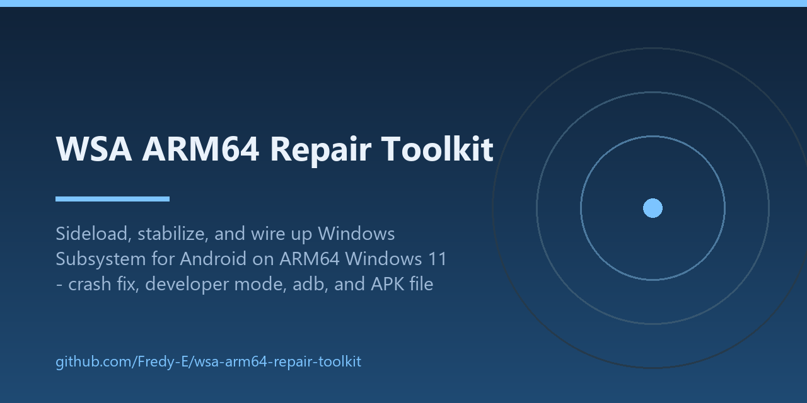

<div align="center">

<h1>WSA ARM64 Repair Toolkit</h1>

<p><strong>Keep Windows Subsystem for Android alive on ARM64 Windows 11.</strong><br>
Crash-fix the WSA client, enable Developer mode safely, wire up adb, and make any <code>.apk</code> double-click install straight into WSA.</p>

<p>


</p>

<p></p>

</div>

## What this is

Tooling and notes from repairing a sideloaded **Windows Subsystem for Android 2407.40000.4.0 (ARM64)** on a Snapdragon X machine running Windows 11 25H2, where the official WSA client (`WsaClient.exe`) crash-loops before the Android VM can stay up.

Everything here is self-authored scripts and documentation. **No Microsoft binaries are redistributed** — the patcher edits *your local copy* of the client, byte-by-byte, with strict verification.

> Not affiliated with Microsoft. WSA is deprecated and no longer distributed by Microsoft; this toolkit is for keeping existing sideloads working.

## What it fixes

| Problem | Fix |
|---|---|
| `WsaClient.exe` crash-loops (`0xc0000409` fail-fast; `ucrtbase.dll` abort `0x7c4dc`; fault offsets in `WsaClient.exe`) | `scripts/Patch-WsaClientArm64.py` — 19 verified byte patches (18 fail-fast traps → `ret`, crash-reporter entry → `ret`) |
| Developer mode can't be enabled by editing `settings.dat` — any hand-written value makes the client crash instantly | `scripts/Enable-WsaDeveloperMode.ps1` — flips the real toggle via UI Automation (the only method that works) |
| `adb` can't connect (port 58526 closed) | Developer mode (above) + `adb connect 127.0.0.1:58526`; first connect may show `unauthorized` for a moment, then authorizes |
| Double-clicking an `.apk` does nothing (no handler exists on sideloaded builds) | `scripts/Install-WsaApkAssociation.ps1` — registers a WSA APK-installer handler for the `.apk` file type |
| `WsaClient` fails to re-register after edits | `scripts/Add-RestrictedAppUriHandlerCapability.ps1` — manifest capability fix (one layer of the repair; see docs) |

## Quick start

Prerequisites: Windows 11 **ARM64** (Snapdragon-class), a sideloaded/development WSA **2407.40000.4.0** ARM64 package you obtained yourself, admin rights, Python 3 and PowerShell 5.1.

```powershell
# 1. Verify your local client matches the supported build, then patch (auto-backup to .orig)
python scripts/Patch-WsaClientArm64.py --check "D:\WSA\install\WsaClient\WsaClient.exe"
python scripts/Patch-WsaClientArm64.py --apply "D:\WSA\install\WsaClient\WsaClient.exe"

# 2. Re-register the development package and start WSA (paths per your setup)
Add-AppxPackage -Register "D:\WSA\install\AppxManifest.xml"
explorer.exe "shell:appsFolder\MicrosoftCorporationII.WindowsSubsystemForAndroid_8wekyb3d8bbwe!App"

# 3. Enable Developer mode (UI Automation; run from an unlocked session)
.\scripts\Enable-WsaDeveloperMode.ps1

# 4. adb
adb connect 127.0.0.1:58526

# 5. Make .apk files double-click-install into WSA
.\scripts\Install-WsaApkAssociation.ps1 -AdbPath "D:\Android\sdk\platform-tools\adb.exe"
```

## Scripts

| Script | Purpose |
|---|---|
| `scripts/Patch-WsaClientArm64.py` | Verify + apply the 19 ARM64 byte patches (auto-backup to `.orig`; refuses unknown builds) |
| `scripts/Enable-WsaDeveloperMode.ps1` | Toggle Developer mode via UI Automation, then wait for the adb port |
| `scripts/Install-WsaApkAssociation.ps1` | Install/uninstall the `.apk` → WSA handler + registry association |
| `scripts/wsa-install-apk.ps1` | The handler itself: connects adb (auto-starts WSA if needed), installs the dropped APK |
| `scripts/Add-RestrictedAppUriHandlerCapability.ps1` | Adds the `restrictedAppUriHandlerHost` capability to an `AppxManifest.xml` (backup + XML validation) |
| `scripts/Show-WsaStatus.ps1` | One-shot status: processes, adb port, recent crash events |

## Evidence and limits

- Byte offsets verified against **WSA 2407.40000.4.0 ARM64** (`WsaClient.exe`, 5,749,248 bytes). Any other build fails `--check` and is left untouched.
- The **x64** client is a different binary — not covered here (see `wesmar/WSAPatch` for x64).
- Tested end-to-end on one Snapdragon X machine (Win11 25H2, build 26200): stable client run, Developer mode via the settings UI, `adb devices` → `device`, and an APK installed via double-click. See `docs/screenshots/`.
- WSA has **no USB passthrough** — USB devices are invisible inside Android; platform limitation, not a bug.
- Screenshots show third-party app UIs running inside WSA as test loads; they are not part of this repository's code.

## Docs

- [`docs/WHAT-WE-FIXED.md`](docs/WHAT-WE-FIXED.md) — the full repair story: crash forensics, the patch table, the Developer-mode discovery.
- [`docs/TROUBLESHOOTING.md`](docs/TROUBLESHOOTING.md) — symptom → fix table.

## See also

Sibling ARM64 projects: [`Fredy-E/USBPcap-ARM64`](https://github.com/Fredy-E/USBPcap-ARM64) · [`Fredy-E/VCDS-ARM64`](https://github.com/Fredy-E/VCDS-ARM64)

Contact: fff.eid607@gmail.com · License: MIT
